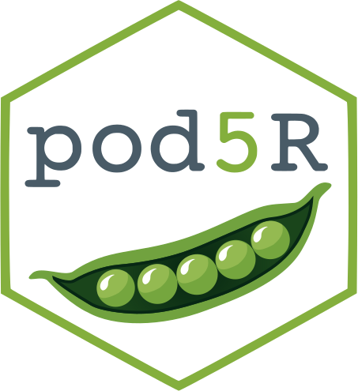

# pod5R 

**An R interface to POD5 files by Oxford Nanopore Technologies**

## Introduction

**pod5R** reads POD5 files through Oxford Nanopore's native C API. It provides read and run metadata, read selection by UUID, raw and calibrated signal extraction, batch processing, and Dorado split-read signal mapping.

Results are returned as ordinary R data frames, lists, and signal vectors. Reading POD5 files does not require Python, reticulate, or the R Arrow package.

The package provides read access. It does not write POD5 files or perform basecalling.


---

## Documentation

**Full documentation:** https://lrb-iimcb.github.io/pod5R/

## Installation


### Existing R installation, including RStudio Workbench

A precompiled package is available for **Ubuntu 24.04 on x86_64, tested with R 4.4.2**. Other operating systems and R versions have not been tested.

The binary requires glibc ≥ 2.38 and a C++ runtime providing `GLIBCXX_3.4.32`, `CXXABI_1.3.11`, and the earlier symbol versions.

Download:

`pod5R_0.2.0_R4.4.2_ubuntu24.04_x86_64.tar.gz`

Save the archive in your home directory on the computer running R. For Workbench, upload it to your home directory on the server using the **Files** pane.

Restart R if pod5R is already loaded, then run the following in the **R console**:

```r
archive <- path.expand(
  "~/pod5R_0.2.0_R4.4.2_ubuntu24.04_x86_64.tar.gz"
)

if (!file.exists(archive)) {
  stop("The downloaded package archive was not found.", call. = FALSE)
}

user_library <- path.expand("~/R/library/4.4")
dir.create(user_library, recursive = TRUE, showWarnings = FALSE)
.libPaths(c(user_library, .libPaths()))

if (!requireNamespace("Rcpp", quietly = TRUE)) {
  utils::install.packages(
    "Rcpp",
    lib = user_library,
    repos = "https://cloud.r-project.org"
  )
}

utils::install.packages(
  archive,
  repos = NULL,
  type = "source",
  lib = user_library
)

library(pod5R)
```

On Linux, `type = "source"` selects the installation route for the local archive. R recognises this archive as precompiled and installs pod5R without recompiling it.

Rcpp is required; installing Rcpp from source may require compiler tools. The precompiled pod5R package does not require Conda, Python, or a separate POD5 installation.

Installation into this personal library does not require administrator privileges or modify environment modules.

In subsequent R sessions, run:

```r
.libPaths(c(path.expand("~/R/library/4.4"), .libPaths()))
library(pod5R)
```

### Separate Conda environment

This option requires Conda and Linux x86_64. It creates a separate environment containing R 4.4 and pod5R.

Download these two release assets into your home directory on the computer where Conda will run:

- `install-pod5R.sh`
- `pod5R-0.2.0-linux-64-r44-channel.tar.gz`

Run in a **terminal**:

```bash
bash "$HOME/install-pod5R.sh" \
  --archive "$HOME/pod5R-0.2.0-linux-64-r44-channel.tar.gz" \
  --prefix "$HOME/.local/share/pod5R/0.2.0-r44"
```

The destination must not already exist. The installer verifies the archive and package checksums, creates the environment, and checks signal extraction. Internet access to conda-forge is required for dependency downloads.

Start the environment's R with:

```bash
conda activate "$HOME/.local/share/pod5R/0.2.0-r44"
R
```

Then load the package:

```r
library(pod5R)
```

Activating Conda in a Workbench terminal does not switch the R interpreter used by an already running Workbench R session.

---

## General usage

Read the first signal from the bundled example file:

```r
pod5_file <- system.file(
  "extdata",
  "drs-filtered.pod5",
  package = "pod5R",
  mustWork = TRUE
)

file_information <- pod5R::read_pod5_info(pod5_file)
read_ids <- pod5R::read_pod5_ids(pod5_file)

result <- pod5R::read_pod5(
  file = pod5_file,
  num_reads = 1,
  signal = TRUE,
  calibrated = TRUE
)

read_metadata <- result$reads
signal_pa <- result$signal[[1]]

length(signal_pa)
# 21908
```

Replace `pod5_file` with the path to your own POD5 file. Use `calibrated = FALSE` to extract raw integer signal instead of current in picoamperes.

For Dorado split reads, use `extract_pod5_signal_dorado()` with a metadata table containing `read_id`, `pi`, `sp`, `ts`, and `ns`. The function maps child reads to the corresponding parent signal; it does not parse BAM files automatically.

Function documentation is available in R:

```r
help(package = "pod5R")
?pod5R::read_pod5
?pod5R::extract_pod5_signal_dorado
```

---

## Troubleshooting

If you encounter a bug, please [open an issue](https://github.com/LRB-IIMCB/pod5R/issues). Include your operating system, R version, installation method, complete error message, and a minimal reproducible example.

The software is still under active development. All suggestions for improvement are welcome. Please note that the code may change frequently, so use it with caution.

---

## Maintainer

Any issues regarding **pod5R** should be addressed to Natalia Gumińska (nguminska (at) iimcb.gov.pl).

**pod5R** was developed in the <a href="https://www.iimcb.gov.pl/en/research/41-laboratory-of-rna-biology-era-chairs-group">Laboratory of RNA Biology</a> (Dziembowski Lab) at the <a href="https://www.iimcb.gov.pl/en/">International Institute of Molecular and Cell Biology</a> in Warsaw.

## Maintainer

Any issues regarding **pod5R** should be addressed to Natalia Gumińska (nguminska (at) iimcb.gov.pl).

**pod5R** was developed in the [Laboratory of RNA Biology](https://www.iimcb.gov.pl/en/research/41-laboratory-of-rna-biology-era-chairs-group) (Dziembowski Lab) 
at the [International Institute of Molecular and Cell Biology](https://www.iimcb.gov.pl/en/) in Warsaw.
