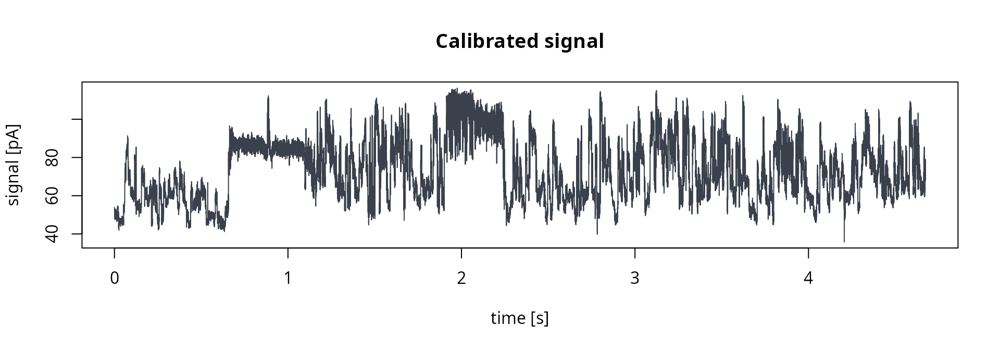
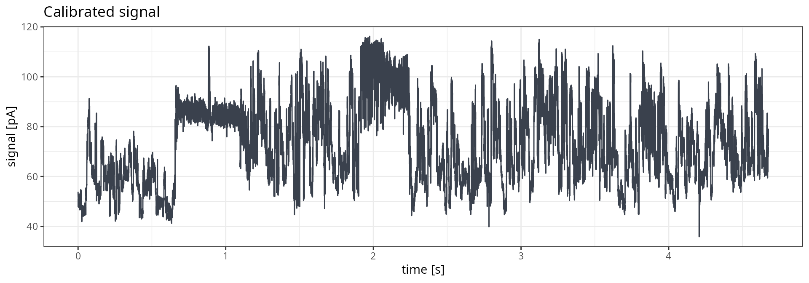
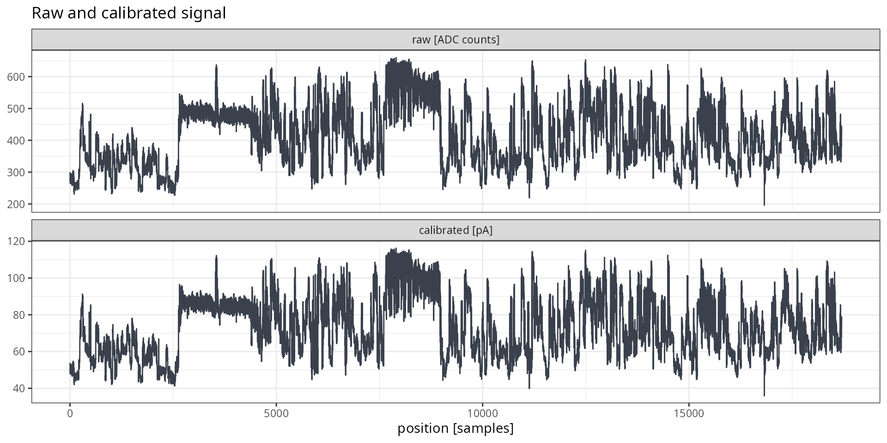
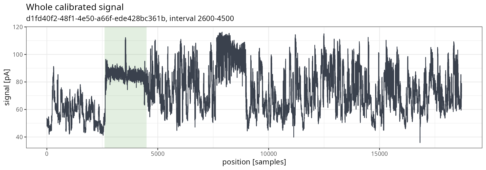
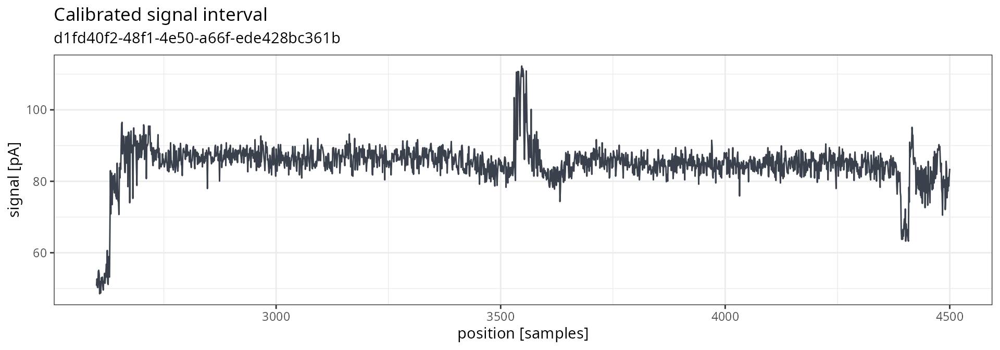

# Signal extraction and plotting

This vignette shows how to extract raw nanopore signals from POD5 files
with **pod5R**, and how to plot them with base R graphics or ggplot2.
Two workflows are covered: direct extraction by read identifier, and
extraction preceded by reading the per-read metadata. We recommend the
second one whenever reads have to be selected by their properties, or
when the signal should be shown on a time axis. Plotting of many reads
is covered in
[`vignette("batch_plotting")`](https://lrb-iimcb.github.io/pod5R/articles/batch_plotting.md).

All examples use a small direct RNA sequencing (DRS) file shipped with
the package. The same calls work for any POD5 file.

> **Note:** pod5R provides read-only access. It does not segment the
> signal, detect poly(A) tails, or perform basecalling.

## Example data

The example file is a real toy DRS dataset provided with the package.
File-level information can be retrieved with
[`read_pod5_info()`](https://lrb-iimcb.github.io/pod5R/reference/read_pod5_info.md):

``` r
pod5_file <- system.file("extdata", "drs-filtered.pod5",
                         package = "pod5R", mustWork = TRUE)

pod5R::read_pod5_info(pod5_file)
## $file_identifier
## [1] "226b4f4e-e309-4e72-9320-6e9877e20700"
## 
## $file_version
## [1] "0.3.46"
## 
## $num_reads
## [1] 42
## 
## $num_batches
## [1] 1
## 
## $num_runs
## [1] 1
```

To work with your own data, assign the path to your POD5 file to
`pod5_file` instead. All the following calls in this vignette then work
unchanged:

``` r
# path to your own POD5 file
pod5_file <- "/path/to/user/provided/file.pod5"

pod5R::read_pod5_info(pod5_file)
```

## Extraction without reading metadata first

### Read identifiers

[`read_pod5_ids()`](https://lrb-iimcb.github.io/pod5R/reference/read_pod5_ids.md)
returns read identifiers (UUIDs) in file order. No signal data are
decompressed at this stage.

``` r

read_ids <- pod5R::read_pod5_ids(pod5_file)

length(read_ids)
## [1] 42
head(read_ids, 3)
## [1] "0e8e52dc-3a71-4c33-9a00-e1209ba4d2e9"
## [2] "e6508401-c6a5-44be-ae64-455e982022ba"
## [3] "a7352eb3-9f1f-41e5-a63c-23cf76565a21"
```

### Raw signal

[`extract_pod5_signal()`](https://lrb-iimcb.github.io/pod5R/reference/extract_pod5_signal.md)
returns a list of signal vectors named by read UUID, in the requested
order. By default, signals are returned raw, as integer ADC counts.

``` r

raw_list <- pod5R::extract_pod5_signal(pod5_file, read_ids = read_ids[1])

str(raw_list)
## List of 1
##  $ 0e8e52dc-3a71-4c33-9a00-e1209ba4d2e9: int [1:21908] 273 290 289 305 291 288 285 273 258 269 ...
```

### Calibrated signal

With `calibrated = TRUE`, signals are returned as numeric vectors in
picoamperes (pA). Calibration uses the per-read values stored in the
file and is computed using formula
`(raw_signal + calibration_offset) * calibration_scale`.

``` r

pa_list <- pod5R::extract_pod5_signal(pod5_file,
                                      read_ids = read_ids[1],
                                      calibrated = TRUE)

str(pa_list)
## List of 1
##  $ 0e8e52dc-3a71-4c33-9a00-e1209ba4d2e9: num [1:21908] 48.3 51.3 51.1 53.9 51.5 ...
```

### Signal intervals

A part of the signal can be requested with `start_sample` and
`end_sample`. Both coordinates are one-based and inclusive. Only
compressed chunks overlapping the interval are decoded, so the
extraction of short windows stays fast even for long reads. Bounds
beyond the end of the read are clipped.

In this example below, the interval is stored in two variables,
`window_start` and `window_end`. They are reused in the
[Plotting](#plotting) section, so the extraction and the plot always
correspond to the same read samples.

``` r
# window used here and in the plotting section below
window_start <- 2600
window_end <- 4500

window_list <- pod5R::extract_pod5_signal(pod5_file,
                                          read_ids = read_ids[1],
                                          calibrated = TRUE,
                                          start_sample = window_start,
                                          end_sample = window_end)

length(window_list[[1]])
## [1] 1901
```

## Extraction with reading metadata first

### Read metadata

[`read_pod5()`](https://lrb-iimcb.github.io/pod5R/reference/read_pod5.md)
returns one row of metadata per read. Unless `signal = TRUE` is set, the
signal data are not decompressed, so the whole file can be scanned
cheaply.

Opening a reader inspects every read batch of the file. When several
calls are made on the same file, the reader should be opened only once
with
[`open_pod5()`](https://lrb-iimcb.github.io/pod5R/reference/open_pod5.md),
reusing it, and closing it with
[`close_pod5()`](https://lrb-iimcb.github.io/pod5R/reference/close_pod5.md).

``` r

reader <- pod5R::open_pod5(pod5_file)

reads <- pod5R::read_pod5(reader)

colnames(reads)
##  [1] "read_id"                  "read_number"             
##  [3] "start_sample"             "num_samples"             
##  [5] "channel"                  "well"                    
##  [7] "pore_type"                "calibration_offset"      
##  [9] "calibration_scale"        "median_before"           
## [11] "end_reason"               "end_reason_forced"       
## [13] "acquisition_id"           "sample_rate"             
## [15] "num_minknow_events"       "open_pore_level"         
## [17] "expected_open_pore_level" "selected_read_level"
head(reads[, c("read_id", "num_samples", "sample_rate", "end_reason")], 3)
##                                read_id num_samples sample_rate      end_reason
## 1 0e8e52dc-3a71-4c33-9a00-e1209ba4d2e9       21908        4000 signal_positive
## 2 e6508401-c6a5-44be-ae64-455e982022ba       23300        4000 signal_positive
## 3 a7352eb3-9f1f-41e5-a63c-23cf76565a21       20462        4000 signal_positive
```

### Selecting reads

Reads can be selected with ordinary R subsetting. In the example below,
the read closest to the median signal length is chosen as a
representative.

``` r

# read closest to the median signal length
selected <- reads[which.min(abs(reads$num_samples - stats::median(reads$num_samples))), ]

selected[, c("read_id", "num_samples", "sample_rate")]
##                                 read_id num_samples sample_rate
## 12 d1fd40f2-48f1-4e50-a66f-ede428bc361b       18700        4000
```

### Metadata and signal in one call

With `signal = TRUE`,
[`read_pod5()`](https://lrb-iimcb.github.io/pod5R/reference/read_pod5.md)
returns a named list with `reads` (metadata in the requested order) and
`signal` (vectors named by UUID). By this, the calibration values and
the sample rate are kept next to the signal.

``` r

out <- pod5R::read_pod5(reader,
                        read_ids = selected$read_id,
                        signal = TRUE)

names(out)
## [1] "reads"  "signal"

str(out[['signal']])
## List of 1
##  $ d1fd40f2-48f1-4e50-a66f-ede428bc361b: int [1:18700] 300 293 290 290 285 272 273 265 283 268 ...

pod5R::close_pod5(reader)
```

Calibration can be reproduced from the raw signal and the metadata. The
result is consistent to the output of `calibrated = TRUE`:

``` r

raw_signal <- out[['signal']][[1]]
pa_signal <- (raw_signal + out[['reads']]$calibration_offset) * out[['reads']]$calibration_scale

# assertion
all.equal(pa_signal,
          pod5R::extract_pod5_signal(pod5_file,
                                     read_ids = selected$read_id,
                                     calibrated = TRUE)[[1]])
## [1] TRUE
```

## Plotting

The signal is plotted in acquisition order. Without metadata, the x axis
shows the sample position. With metadata, positions are converted to
time using the read `sample_rate`. The first sample placed at 0 s.

``` r

signal_df <- data.frame(
  position = seq_along(raw_signal),
  # rescale time to seconds
  time = (seq_along(raw_signal) - 1) / out[['reads']]$sample_rate,
  raw = raw_signal,
  pa = pa_signal)

head(signal_df, 3)
##   position    time raw       pa
## 1        1 0.00000 300 53.88410
## 2        2 0.00025 293 52.67127
## 3        3 0.00050 290 52.15149
```

Plotting every sample of very long reads may be slow and place heavy
load on memory. In such scenarios, extracting only interval with
`start_sample` and `end_sample` is recommended.

### Base R

Raw signal on the sample axis (no metadata required):

``` r

graphics::plot(signal_df$position, signal_df$raw,
               type = "l",
               col = "#3a414d",
               xlab = "position [samples]",
               ylab = "signal [ADC counts]",
               main = "Raw signal")
```


Calibrated signal on the time axis (samples converted to seconds):

``` r

graphics::plot(signal_df$time, signal_df$pa,
               type = "l",
               col = "#3a414d",
               xlab = "time [s]",
               ylab = "signal [pA]",
               main = "Calibrated signal")
```



### ggplot2

The examples below require ggplot2 to be installed; otherwise, their
chunks are skipped.

``` r

g.base <- ggplot2::ggplot(signal_df, ggplot2::aes(x = time, y = pa))
g.line <- ggplot2::geom_line(color = "#3a414d")
g.labs <- ggplot2::labs(title = "Calibrated signal",
                        x = "time [s]",
                        y = "signal [pA]")

plot_signal <- g.base + g.line + g.labs + ggplot2::theme_bw()

print(plot_signal)
```



Raw and calibrated signals can be compared in two panels. Since
calibration only shifts and scales the signal, both panels have the same
shape:

``` r

scale_levels <- c("raw [ADC counts]", "calibrated [pA]")

comparison_df <- data.frame(
  position = rep(signal_df$position, 2),
  signal = c(signal_df$raw, signal_df$pa),
  scale = factor(rep(scale_levels, each = nrow(signal_df)), levels = scale_levels))

g.base <- ggplot2::ggplot(comparison_df, ggplot2::aes(x = position, y = signal))
g.line <- ggplot2::geom_line(color = "#3a414d")
g.facet <- ggplot2::facet_wrap(~scale, ncol = 1, scales = "free_y")
g.labs <- ggplot2::labs(title = "Raw and calibrated signal",
                        x = "position [samples]",
                        y = NULL)

plot_comparison <- g.base + g.line + g.facet + g.labs + ggplot2::theme_bw()
print(plot_comparison)
```



### Signal interval

A signal interval is plotted the same way. Positions are offset by
`start_sample`, so that the x axis keeps the whole-read coordinates.

In the example below, the interval delimited by `window_start` and
`window_end` is extracted from the selected read (the same previous one,
i.e. the read already shown in the plots above), The read identifier is
displayed in the subtitle of both plots.

``` r

window_signal <- pod5R::extract_pod5_signal(pod5_file,
                                            read_ids = selected$read_id,
                                            calibrated = TRUE,
                                            start_sample = window_start,
                                            end_sample = window_end)[[1]]

# assertion - whether the interval equals the same samples of the whole read
# should return TRUE
identical(window_signal, signal_df$pa[window_start:window_end])
## [1] TRUE

# positions keep the coordinates of the whole read
window_df <- data.frame(
  position = window_start + seq_along(window_signal) - 1,
  pa = window_signal
)
```

The whole signal, with the extracted interval shaded:

``` r
g.base <- ggplot2::ggplot(signal_df, ggplot2::aes(x = position, y = pa))
g.rect <- ggplot2::annotate("rect", xmin = window_start, xmax = window_end,
                            ymin = -Inf, ymax = Inf, fill = "#449434", alpha = .15)
g.line <- ggplot2::geom_line(color = "#3a414d")
g.labs <- ggplot2::labs(title = "Whole calibrated signal",
                        subtitle = paste0(selected$read_id, ", interval ",
                                          window_start, "-", window_end),
                        x = "position [samples]",
                        y = "signal [pA]")

plot_full <- g.base + g.rect + g.line + g.labs + ggplot2::theme_bw()
print(plot_full)
```



The interval alone. For the purpose of this example, the poly(A) tail
was selected. Its shape matches the shaded part of the plot above:

``` r
g.base <- ggplot2::ggplot(window_df, ggplot2::aes(x = position, y = pa))
g.line <- ggplot2::geom_line(color = "#3a414d")
g.labs <- ggplot2::labs(title = "Calibrated signal interval",
                        subtitle = selected$read_id,
                        x = "position [samples]",
                        y = "signal [pA]")

plot_window <- g.base + g.line + g.labs + ggplot2::theme_bw()
print(plot_window)
```



To inspect another chunk of the read, `window_start` and `window_end`
should be changed and the interval chunks are run again. Changing only
the positions in `window_df` would relabel the x axis without extracting
different part of the signal

## Summary of functions used

| Function | Description | Decompresses signal |
|----|----|----|
| [`read_pod5_info()`](https://lrb-iimcb.github.io/pod5R/reference/read_pod5_info.md) | File-level information | no |
| [`read_pod5_ids()`](https://lrb-iimcb.github.io/pod5R/reference/read_pod5_ids.md) | Read identifiers in file order | no |
| [`read_pod5()`](https://lrb-iimcb.github.io/pod5R/reference/read_pod5.md) | Read metadata; signal with `signal = TRUE` | only with `signal = TRUE` |
| [`extract_pod5_signal()`](https://lrb-iimcb.github.io/pod5R/reference/extract_pod5_signal.md) | Raw or calibrated signal vectors | yes |
| [`open_pod5()`](https://lrb-iimcb.github.io/pod5R/reference/open_pod5.md) / [`close_pod5()`](https://lrb-iimcb.github.io/pod5R/reference/close_pod5.md) | Open and close a reusable reader | no |
